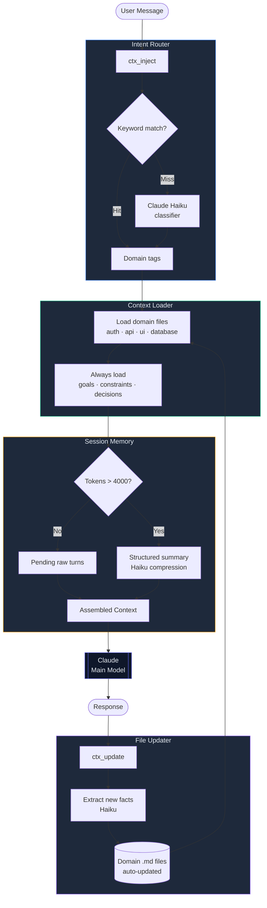

# ctx-flow

Project memory and selective context loading for coding agents. The optional MCP server routes requests to relevant Markdown notes and can use Claude Haiku to extract facts and summarize stored conversation history. A portable skill is available in `skills/ctx-flow/`.

The skill works with local file tools. The MCP server is a separate integration; neither automatically replaces or compacts the host agent's conversation.

## How it works



## Skill installation

Install `skills/ctx-flow/` using your agent's skill installer, or copy that directory to the agent's skills location. It contains `SKILL.md` and a reference for the optional MCP server. For a marketplace ZIP, zip the **contents** of that directory so `SKILL.md` is at the archive root. Keep the included MIT license.

The skill can maintain and selectively read project context without an API key or Node.js. It does not install the server or register hooks.

## Token usage

Selective context loading and successful summarization can reduce the context supplied by an integration that uses them. There is no reproducible benchmark in this repository establishing a fixed savings percentage or an accuracy improvement. Count the host's retained history, injected notes, tool output, and helper API calls when measuring total usage.

## Setup: optional MCP server

### 1. Install from source

Use Node.js 20.19+ or a supported newer LTS. As of October 18, 2026, `ctx-flow` is not available from the public npm registry; the previous `npm install -g ctx-flow` instruction returns 404.

```bash
git clone https://github.com/bansalbhunesh/ctx-flow.git
cd ctx-flow
npm ci
npm run build
node bin/ctx-flow.js --help
```

### 2. Scaffold the context directory in your project

```bash
cd /path/to/your/project
node /absolute/path/to/ctx-flow/bin/ctx-flow.js init .
```

This creates `context/` with starter `goals.md`, `constraints.md`, `decisions.md`, and `domains/{auth,api,ui,database}.md` files.

### 3. Set your API key

```bash
export ANTHROPIC_API_KEY=your_key_here
```

> The key is optional. Without it, keyword routing, file access, and direct fact writing work locally. History stays uncompressed. On Windows PowerShell, set an existing key through your secure environment configuration; do not commit it to this repository.

### 4. Register with Claude Code

Run from the project whose context you want to manage:

```bash
claude mcp add --scope project --transport stdio ctx-flow -- node /absolute/path/to/ctx-flow/bin/ctx-flow.js mcp
```

Quote paths containing spaces. Project registration is stored in `.mcp.json`, not `.claude/settings.json`. The `.mcp.json` in this source repository starts its built server through `bin/ctx-flow.js mcp`. Calling `node dist/index.js` only imports the module and does not start the server.

For another MCP client, use `node` as the command and the absolute binary path plus `mcp` as its arguments. Set `CTX_FLOW_CONTEXT_DIR` to the absolute path of the target project's `context` directory if the client starts the process elsewhere. Otherwise the default uses `CLAUDE_PROJECT_DIR` when available, then the process working directory.

Verify that the four `ctx_*` tools are visible in your client. Tools run when the host calls them; registration alone does not install before/after-prompt hooks.

## CLI

```
ctx-flow [command]

Commands:
  mcp                  Start the MCP server (default)
  init [dir]           Scaffold context/ in the given directory (default: cwd)
  --version, -v        Print the installed version
  --help, -h           Print help
```

## Configuration

Drop a `ctx-flow.config.json` next to your `context/` directory to override defaults:

```json
{
  "contextDir": "./context",
  "tokenThreshold": 4000,
  "haikuModel": "claude-haiku-4-5-20251001",
  "keywordMap": {
    "auth": ["login", "jwt", "session"],
    "billing": ["invoice", "stripe", "payment"]
  }
}
```

All fields are optional. Relative `contextDir` values are resolved from the selected config file. `keywordMap` extends each domain's built-in keywords. Invalid config shapes fall back to defaults with a diagnostic on stderr.

Environment overrides:
- `CTX_FLOW_CONFIG` — path to a config file (default: `./ctx-flow.config.json`)
- `CTX_FLOW_CONTEXT_DIR` — overrides `contextDir`
- `ANTHROPIC_API_KEY` — required for Haiku-powered features

## Context files

Edit these files to give Claude persistent knowledge about your project:

```
context/
├── goals.md          # project goals — always injected
├── constraints.md    # hard constraints — always injected
├── decisions.md      # decisions made — always injected
└── domains/
    ├── auth.md       # injected when message is about auth
    ├── api.md        # injected when message is about the API
    ├── ui.md         # injected when message is about UI
    └── database.md   # injected when message is about the DB
```

Add domain files using names of 1–64 letters, digits, underscores, or hyphens, starting with a letter or digit. Reserved Windows device names are rejected. The router discovers regular Markdown files; symlink and junction redirects below the context root are rejected.

**Example `goals.md`:**

```markdown
# Project Goals

- Ship v2 auth system by end of Q2
- Migrate from REST to GraphQL
- Reduce API response time to < 100ms
```

**Example `domains/auth.md`:**

```markdown
# Auth Domain

- JWT tokens, 1h expiry
- Refresh token rotation with 30s grace window
- Auth endpoints: /api/auth/login, /api/auth/refresh
- Token family approach — full family invalidated on reuse
```

## MCP tools

Suggested orchestration for a client that explicitly calls these tools:

| Tool | When to call | What it does |
|------|-------------|--------------|
| `ctx_inject` | Before a request needing project memory | Returns core notes, relevant domain notes, summary, and pending turns |
| `ctx_update` | After a turn you want stored | Persists the turn, then optionally extracts facts and compresses history |
| `ctx_reset` | When a conversation reset is requested | Clears stored turns and summary, keeps context files |
| `ctx_write_fact` | When user states a new fact | Directly appends to a domain file |

### Example usage in your own code

```typescript
import Anthropic from "@anthropic-ai/sdk";

const client = new Anthropic();

// 1. Get context before sending to Claude
const injectResult = await mcpClient.callTool({ name: "ctx_inject", arguments: { message: userMessage } });
const context = JSON.parse(injectResult.content[0].text).context;

// 2. Build prompt with injected context
const response = await client.messages.create({
  model: "claude-sonnet-4-6",
  max_tokens: 1024,
  system: context,
  messages: [{ role: "user", content: userMessage }],
});

// 3. Update session after response
await mcpClient.callTool({
  name: "ctx_update",
  arguments: {
    message: userMessage,
    response: response.content.filter((block) => block.type === "text").map((block) => block.text).join("\n"),
    detectedDomains: ["auth"],
  },
});
```

## Intent routing

The router uses two tiers:

**Tier 1 — keyword match (free, instant)**

Checks the message against a keyword map per domain:

```typescript
const KEYWORD_MAP = {
  auth:     ["login", "token", "jwt", "session", "password", ...],
  api:      ["endpoint", "route", "request", "response", "http", ...],
  ui:       ["component", "button", "form", "modal", "css", ...],
  database: ["query", "table", "schema", "migration", "sql", ...],
};
```

**Tier 2 — Haiku fallback (fires only on keyword miss)**

Sends the message to the configured Haiku model to classify intent. API costs depend on model pricing and the input/output tokens.

Extend the keyword map in `ctx-flow.config.json`.

## Summarization

When pending history reaches the configured threshold (4,000 estimated tokens by default), ctx-flow attempts compression if an API key is available. Pending turns are persisted and included by `ctx_inject` before compression. Without a key, on API errors, or on malformed summary output, the original turns remain available.

Summary shape:

```json
{
  "goals": ["..."],
  "facts": ["..."],
  "decisions": ["..."],
  "constraints": ["..."],
  "openQuestions": ["..."]
}
```

The previous summary is supplied to each compression request. Model summaries are lossy and should be checked for important omissions; permanent goals, constraints, and decisions belong in the core files.

## Privacy and session limits

`ctx_update` stores raw pending turns and summaries in `context/.session.json`. Exclude that file from version control in every target project, and avoid storing secrets. When an API key is enabled, classification sends the user message to Anthropic, extraction sends the turn and selected notes, and compression sends pending turns and the previous summary.

Without successful compression, stored history and injected context can grow. `ctx_reset` clears stored conversation history while preserving Markdown notes. Mutations are serialized within one server process. Separate processes or independent sessions should use separate context directories; cross-process writes are not coordinated. This is a local stdio tool, not a filesystem sandbox against concurrent hostile local processes.

## Project structure

```
ctx-flow/
├── src/
│   ├── index.ts                    # MCP server entry point
│   ├── types.ts                    # shared interfaces
│   ├── router/
│   │   └── intent-router.ts        # two-tier domain classifier
│   ├── summarizer/
│   │   └── compressor.ts           # structured history compression
│   └── context/
│       └── file-manager.ts         # auto-updates domain files
├── context/
│   ├── goals.md
│   ├── constraints.md
│   ├── decisions.md
│   └── domains/
├── skills/ctx-flow/                # portable SKILL.md and MCP reference
├── .mcp.json                       # source-checkout MCP registration
├── dist/                           # compiled output (git-ignored)
├── package.json
└── tsconfig.json
```

## Development

```bash
npm run dev     # watch mode — recompiles on save
npm run build   # one-shot build
npm start       # run the MCP server directly
```

## License

MIT
