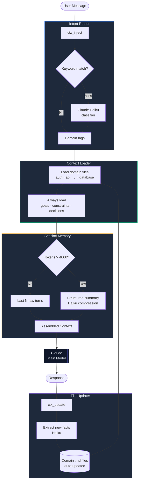

# ctx-flow

Intent-aware context injection plugin for Claude Code. Reduces token usage by 60–98% on long sessions while improving response accuracy by loading only the context that matters for each message.

## How it works



## Token savings

| Session length | Without ctx-flow | With ctx-flow | Saved |
|----------------|-----------------|---------------|-------|
| 20 turns       | ~8,000 tokens   | ~1,200 tokens | 85%   |
| 50 turns       | ~20,000 tokens  | ~1,800 tokens | 91%   |
| Domain task    | ~6,000 tokens   | ~800 tokens   | 87%   |

## Setup

### 1. Install

From npm (recommended):

```bash
npm install -g ctx-flow
```

Or from source:

```bash
git clone https://github.com/bansalbhunesh/ctx-flow.git
cd ctx-flow
npm install
npm run build
```

### 2. Scaffold the context directory in your project

```bash
cd /path/to/your/project
ctx-flow init
```

This creates `context/` with starter `goals.md`, `constraints.md`, `decisions.md`, and `domains/{auth,api,ui,database}.md` files.

### 3. Set your API key

```bash
export ANTHROPIC_API_KEY=your_key_here
```

> Without a key the plugin still works — it uses keyword routing and a minimal fallback summary. Haiku-powered extraction and summarization require the key.

### 4. Register with Claude Code

Add to your project's `.claude/settings.json`:

```json
{
  "mcpServers": {
    "ctx-flow": {
      "command": "ctx-flow",
      "args": ["mcp"]
    }
  }
}
```

If you installed from source, point at the binary instead:

```json
{
  "mcpServers": {
    "ctx-flow": {
      "command": "node",
      "args": ["bin/ctx-flow.js", "mcp"],
      "cwd": "/absolute/path/to/ctx-flow"
    }
  }
}
```

Then restart Claude Code.

## CLI

```
ctx-flow [command]

Commands:
  mcp                  Start the MCP server (default)
  init [dir]           Scaffold context/ in the given directory (default: cwd)
  --version, -v        Print the installed version
  --help, -h           Print help
```

## Configuration

Drop a `ctx-flow.config.json` next to your `context/` directory to override defaults:

```json
{
  "contextDir": "./context",
  "tokenThreshold": 4000,
  "haikuModel": "claude-haiku-4-5-20251001",
  "keywordMap": {
    "auth": ["login", "jwt", "session"],
    "billing": ["invoice", "stripe", "payment"]
  }
}
```

All fields are optional. `keywordMap` is merged with the built-in defaults — list a domain there to extend it.

Environment overrides:
- `CTX_FLOW_CONFIG` — path to a config file (default: `./ctx-flow.config.json`)
- `CTX_FLOW_CONTEXT_DIR` — overrides `contextDir`
- `ANTHROPIC_API_KEY` — required for Haiku-powered features

## Context files

Edit these files to give Claude persistent knowledge about your project:

```
context/
├── goals.md          # project goals — always injected
├── constraints.md    # hard constraints — always injected
├── decisions.md      # decisions made — always injected
└── domains/
    ├── auth.md       # injected when message is about auth
    ├── api.md        # injected when message is about the API
    ├── ui.md         # injected when message is about UI
    └── database.md   # injected when message is about the DB
```

Add new domain files freely — the router picks them up automatically.

**Example `goals.md`:**

```markdown
# Project Goals

- Ship v2 auth system by end of Q2
- Migrate from REST to GraphQL
- Reduce API response time to < 100ms
```

**Example `domains/auth.md`:**

```markdown
# Auth Domain

- JWT tokens, 1h expiry
- Refresh token rotation with 30s grace window
- Auth endpoints: /api/auth/login, /api/auth/refresh
- Token family approach — full family invalidated on reuse
```

## MCP tools

Claude Code calls these automatically once registered:

| Tool | When to call | What it does |
|------|-------------|--------------|
| `ctx_inject` | Before every prompt | Returns relevant context to prepend |
| `ctx_update` | After every response | Updates session, compresses if needed, extracts new facts |
| `ctx_reset` | Start of new task | Clears session state, keeps context files |
| `ctx_write_fact` | When user states a new fact | Directly appends to a domain file |

### Example usage in your own code

```typescript
import Anthropic from "@anthropic-ai/sdk";

const client = new Anthropic();

// 1. Get context before sending to Claude
const injectResult = await mcpClient.callTool("ctx_inject", { message: userMessage });
const context = JSON.parse(injectResult.content[0].text).context;

// 2. Build prompt with injected context
const response = await client.messages.create({
  model: "claude-sonnet-4-6",
  max_tokens: 1024,
  system: context,
  messages: [{ role: "user", content: userMessage }],
});

// 3. Update session after response
await mcpClient.callTool("ctx_update", {
  message: userMessage,
  response: response.content[0].text,
  detectedDomains: ["auth"],
});
```

## Intent routing

The router uses two tiers:

**Tier 1 — keyword match (free, instant)**

Checks the message against a keyword map per domain:

```typescript
const KEYWORD_MAP = {
  auth:     ["login", "token", "jwt", "session", "password", ...],
  api:      ["endpoint", "route", "request", "response", "http", ...],
  ui:       ["component", "button", "form", "modal", "css", ...],
  database: ["query", "table", "schema", "migration", "sql", ...],
};
```

**Tier 2 — Haiku fallback (fires only on keyword miss)**

Sends the message to `claude-haiku-4-5` to classify intent. Costs ~$0.000025 per call.

To extend the keyword map, edit `src/router/intent-router.ts`.

## Summarization

When accumulated tokens exceed 4,000, the compressor fires automatically:

```
20 raw turns  →  Haiku  →  structured summary
(1,880 tokens)            (31 tokens)
                           98% reduction
```

Summary shape:

```json
{
  "goals": ["..."],
  "facts": ["..."],
  "decisions": ["..."],
  "constraints": ["..."],
  "openQuestions": ["..."]
}
```

Summaries are **incremental** — each compression merges into the previous one so nothing is lost across multiple compression cycles.

## Project structure

```
ctx-flow/
├── src/
│   ├── index.ts                    # MCP server entry point
│   ├── types.ts                    # shared interfaces
│   ├── router/
│   │   └── intent-router.ts        # two-tier domain classifier
│   ├── summarizer/
│   │   └── compressor.ts           # structured history compression
│   └── context/
│       └── file-manager.ts         # auto-updates domain files
├── context/
│   ├── goals.md
│   ├── constraints.md
│   ├── decisions.md
│   └── domains/
├── .claude/
│   └── settings.json               # MCP registration for Claude Code
├── dist/                           # compiled output (git-ignored)
├── package.json
└── tsconfig.json
```

## Development

```bash
npm run dev     # watch mode — recompiles on save
npm run build   # one-shot build
npm start       # run the MCP server directly
```

## License

MIT
